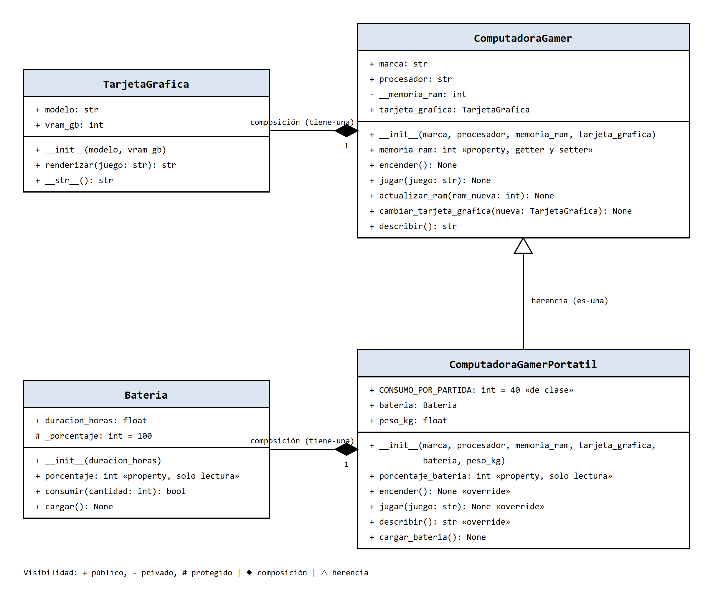

# Computadora Gamer (POO en Python)

Proyecto personal de Programación Orientada a Objetos. Modela computadoras gamer
de escritorio y portátiles.

## Estructura (Avance 3)

```
computadora-gamer-poo/
├── modelos.py   # Clases: TarjetaGrafica, Bateria, ComputadoraGamer, ComputadoraGamerPortatil
├── main.py      # Importaciones, instanciación de objetos y pruebas
├── sistema.py   # Versión del Avance 2 (todo en un solo archivo), se conserva como referencia
└── assets/
    └── diagrama_uml.png
```

## Cómo ejecutarlo

```bash
python main.py
```

## Conceptos aplicados

- Encapsulamiento: `__memoria_ram` privado con `@property` (getter y setter que valida).
- Herencia: `ComputadoraGamerPortatil` extiende `ComputadoraGamer` usando `super()`.
- Polimorfismo: `encender()`, `jugar()` y `describir()` se sobrescriben en la subclase.
- Composición: una `ComputadoraGamer` *tiene-una* `TarjetaGrafica` y una portátil además
  *tiene-una* `Bateria`; sus métodos se usan de forma delegada.
- Modularidad: las clases viven en `modelos.py` y las pruebas en `main.py`.

## Diagrama UML


